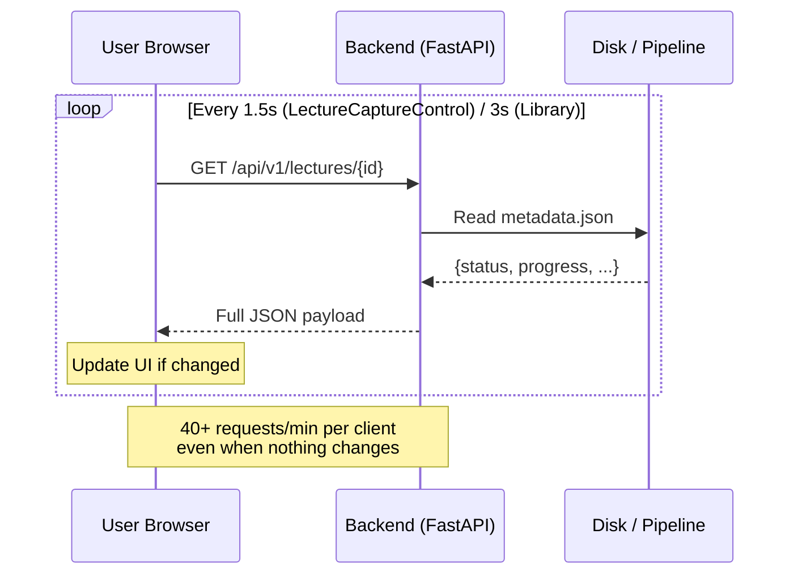
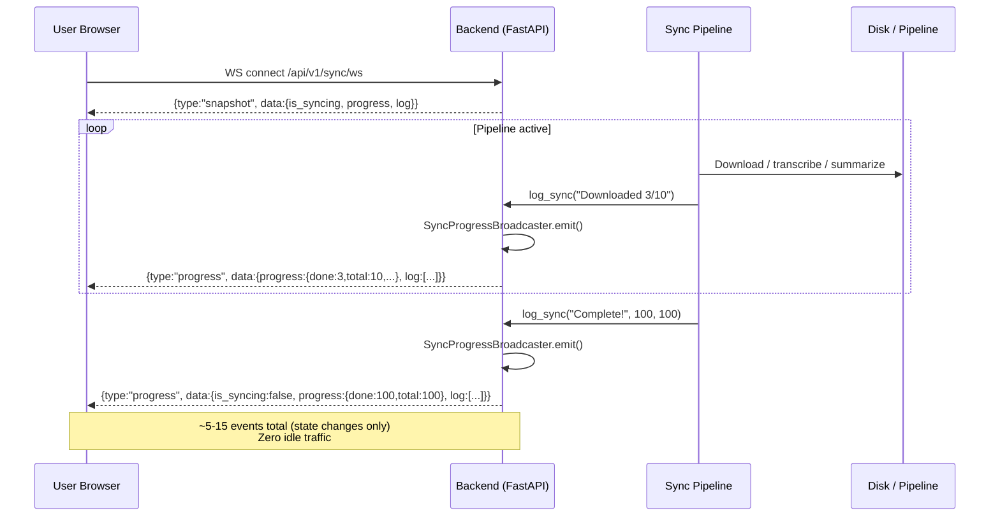

# P2-16: WebSocket Progress Replacement for Sync Polling

**Status:** Design  
**Author:** Oracle  
**Date:** 2026-08-26  
**Scope:** Replace HTTP polling for sync / lecture-processing progress with WebSocket push.

---

## 1. Current Polling Inventory

Three independent polling loops exist today. None share state or coordinate.

### 1.1 Lecture Processing Status — 1.5 s poll

**File:** `web/components/sidebar/LectureCaptureControl.tsx:47-56`

```ts
const timer = window.setInterval(async () => {
  const result = await apiFetch(apiUrl(`/api/v1/lectures/${itemId}`));
  // ... update label, clear interval on terminal status
}, 1500);
```

- **Trigger:** User records a lecture via sidebar mic button.
- **Poll target:** `GET /api/v1/lectures/{id}` (returns full metadata JSON).
- **Duration:** Tied to download + transcribe + summarize pipeline (30s–5min).
- **Client count:** ≤ 1 (single-user; sidebar widget is always singleton).

### 1.2 Media Library Refresh — 3 s poll

**File:** `web/app/(workspace)/library/page.tsx:271`

```ts
const timer = window.setInterval(() => void refresh(), 3000);
```

- **Trigger:** Page mount.
- **Poll target:** `GET /api/v1/lectures` (returns all items).
- **Duration:** Always running while Library tab is open.
- **Client count:** 1 per browser tab.

### 1.3 Sync Engine Progress — orphaned endpoint

**File:** `deeptutor/api/routers/sync_engine.py:84-87`

```python
@router.get("/progress")
async def get_progress() -> dict[str, Any]:
    return sync_status
```

This router is **not mounted** in `main.py` (no `app.include_router(sync_engine.router, …)`). The `GET /progress` endpoint is dead code. However, the `log_sync()` function (line 53) writes to the module-level `sync_status` dict and would need a WS broadcast path once re-activated.

### 1.4 Cost Analysis

| Metric | Current (polling) | Notes |
|---|---|---|
| Requests per client per minute (1.5s poll) | ~40 | `60 / 1.5` |
| Requests per client per minute (3s poll) | ~20 | `60 / 3` |
| Payload size per poll | 0.5–5 KB | Full metadata JSON, most fields unused |
| Estimated monthly bandwidth (single client, 3s poll, 8h/day) | ~200 MB | `20 req/min × 480 min × 3 KB × 30 days` |
| Server CPU per poll | JSON serialization + disk read | `lectures` endpoint reads `data/media/` |
| Concurrent clients (multi-user Docker) | N | Linear scaling |

**WebSocket alternative:** 1 connection per client, ~0.1 KB per progress event, server pushes only on state change. Zero idle traffic.

---

## 2. Proposed Architecture

### 2.1 Decision: New `/api/v1/sync/ws` Endpoint (NOT Reuse unified_ws)

| Approach | Pros | Cons |
|---|---|---|
| **A. Extend `/api/v1/ws` (unified_ws)** | Single connection; client multiplexing | Tightly couples sync lifecycle to chat turn lifecycle; adds message-type complexity to an already-312-line handler; sync is a background process, not a turn |
| **B. New `/api/v1/sync/ws`** | Clean separation of concerns; independent lifecycle; matches `ProgressBroadcaster` precedent for KB progress | Extra WebSocket connection; slightly more client state |
| **C. Extend `ProgressBroadcaster` singleton** | Reuse existing singleton pattern | Broadcaster is KB-scoped (`kb_name` → connections); sync is global, not KB-scoped |

**Recommendation: B — New dedicated endpoint.**

**Justification:**
1. Sync is a **process-level background job**, not a per-turn stream. The `unified_ws` handler is purpose-built for chat turn subscriptions with `subscribe_turn`, `resume_from`, etc. Bolting sync onto it would require reworking the message router (line 102-312 of `unified_ws.py`) and adding a second subscription model.
2. `StreamBus` is per-turn (created per `start_turn`, registered/unregistered in `_bus_registry`). Sync has no turn_id — it's a global singleton process.
3. The `ProgressBroadcaster` pattern (singleton, `kb_name → set[WebSocket]`) is almost exactly right. We create a `SyncProgressBroadcaster` with a single key.
4. One extra WS connection is negligible overhead vs the 40+ HTTP requests/minute it replaces.

### 2.2 Architecture Diagram

```
┌─────────────────────────────────────────────────────┐
│                    Frontend                          │
│                                                      │
│  useSyncProgress() ← hook                           │
│    ├─ new WebSocket("/api/v1/sync/ws")               │
│    ├─ onmessage → setState({is_syncing, progress, log})│
│    └─ fallback: GET /api/v1/sync/poll (3s)           │
│                                                      │
│  LectureCaptureControl                               │
│    └─ uses useSyncProgress() or per-item WS          │
│                                                      │
│  Library Page (auto-refresh)                         │
│    └─ uses media list WS or 30s polling              │
└──────────────┬──────────────────────┬───────────────┘
               │ WS                   │ HTTP (fallback)
               ▼                      ▼
┌──────────────────────────────────────────────────────┐
│                   Backend                            │
│                                                      │
│  /api/v1/sync/ws          GET /api/v1/sync/poll      │
│  (WebSocket endpoint)     (backward compat)          │
│       │                          │                   │
│       ▼                          ▼                   │
│  SyncProgressBroadcaster ←── sync_status dict        │
│  (singleton, broadcast)     (same source of truth)  │
│       ▲                                              │
│       │ emit()                                       │
│  sync_engine.py                                      │
│  log_sync() ─── also calls broadcaster.emit()        │
└──────────────────────────────────────────────────────┘
```

### 2.3 Mermaid Sequence Diagrams

#### Current: Polling



#### Proposed: WebSocket Push



---

## 3. Message Schema

### 3.1 Server → Client

```jsonc
// Snapshot: sent immediately on connect
{
  "type": "snapshot",
  "data": {
    "is_syncing": false,
    "progress": { "done": 0, "total": 0, "message": "" },
    "log": []                       // last 100 messages
  }
}

// Incremental: sent on each log_sync() call
{
  "type": "progress",
  "data": {
    "is_syncing": true,
    "progress": { "done": 30, "total": 100, "message": "[COMP10001] Found 5 modules." },
    "log": [
      "Discovered 8 Canvas courses via Hybrid browser scrape!",
      "[COMP10001] Found 5 modules.",
      "[COMP10001] Indexed 12 rich text pages!"
    ]
  }
}

// Terminal: sync finished or errored
{
  "type": "complete",
  "data": {
    "is_syncing": false,
    "progress": { "done": 100, "total": 100, "message": "Hybrid Echo360 Sync Complete!" },
    "log": [ /* full last-100 log */ ]
  }
}

// Heartbeat (every 30s, to detect dead connections)
{
  "type": "ping"
}
```

### 3.2 Client → Server

```jsonc
// Keepalive pong
{ "type": "pong" }

// Force reconnect / re-snapshot
{ "type": "subscribe" }
```

### 3.3 Schema Rationale

- Mirrors existing `ProgressBroadcaster` format (`{type: "progress", data: {...}}`) for consistency with KB progress.
- Full log included in every message so late-joining clients get the complete picture without a separate REST call. Log is capped at 100 entries (matches current `sync_status["log"][-100:]`).
- `snapshot` vs `progress` vs `complete` allows the frontend to distinguish initial state from incremental updates without parsing progress values.

---

## 4. Backend Emit Points

### 4.1 Current `log_sync()` — the single mutation point

**File:** `deeptutor/api/routers/sync_engine.py:53-66`

```python
def log_sync(message: str, done: int = 0, total: int = 0):
    logger.info(message)
    sync_status["progress"] = {"message": message, "done": done, "total": total}
    sync_status["log"].append(message)
    if len(sync_status["log"]) > 100:
        sync_status["log"] = sync_status["log"][-100:]
```

**Change:** After mutating `sync_status`, also emit to broadcaster:

```python
def log_sync(message: str, done: int = 0, total: int = 0):
    logger.info(message)
    sync_status["progress"] = {"message": message, "done": done, "total": total}
    sync_status["log"].append(message)
    if len(sync_status["log"]) > 100:
        sync_status["log"] = sync_status["log"][-100:]
    # P2-16: push to WebSocket subscribers
    _schedule_broadcast()
```

Since `log_sync()` is called from async contexts (`sync_payload`, `_run_sync_pipeline`) that already hold `_sync_lock`, we need a non-blocking broadcast:

```python
import asyncio

def _schedule_broadcast():
    """Fire-and-forget broadcast. Safe to call from sync or async context."""
    try:
        loop = asyncio.get_running_loop()
        loop.call_soon_threadsafe(lambda: asyncio.ensure_future(_do_broadcast()))
    except RuntimeError:
        pass  # no event loop (sync thread) — skip

async def _do_broadcast():
    from deeptutor.api.routers.sync_ws import get_sync_broadcaster
    broadcaster = get_sync_broadcaster()
    await broadcaster.broadcast(dict(sync_status))
```

### 4.2 All `log_sync()` Call Sites (no changes needed)

| Location | Context | Count |
|---|---|---|
| `sync_engine.py:151,157,160,162` | `sync_payload()` — Canvas courses | 4 |
| `sync_engine.py:182,207,332,334,338,346` | `sync_payload()` — Echo360 sections | 6 |
| `sync_engine.py:411,415,423,428,437,446,448,450` | `_run_sync_pipeline()` — native sync | 8 |

All calls flow through the single `log_sync()` function, so the broadcast hook covers every emit point.

### 4.3 `is_syncing` Transition Points

The `sync_status["is_syncing"]` flag is set at:
- `sync_engine.py:146` (set True — start of `sync_payload`)
- `sync_engine.py:350` (set False — end of `sync_payload`)
- `sync_engine.py:409` (set True — start of `_run_sync_pipeline`)
- `sync_engine.py:455` (set False — end of `_run_sync_pipeline`)

These transitions should also emit a `snapshot` or `progress` event so the client sees the state change immediately. The `_schedule_broadcast()` call inside `log_sync()` already covers the mid-pipeline transitions; the start/end transitions need explicit broadcast calls adjacent to the flag mutations.

---

## 5. Frontend Hook: `useSyncProgress`

### 5.1 Design

Create `web/hooks/useSyncProgress.ts` following the established `useKnowledgeProgress` pattern:

```ts
// web/hooks/useSyncProgress.ts
export interface SyncProgressData {
  is_syncing: boolean;
  progress: { done: number; total: number; message: string };
  log: string[];
}

export function useSyncProgress(): SyncProgressData {
  // 1. Connect to /api/v1/sync/ws on mount
  // 2. Parse incoming messages (snapshot / progress / complete)
  // 3. Return { is_syncing, progress, log } as React state
  // 4. Fallback to GET /api/v1/sync/poll every 3s if WS fails
  // 5. Auto-reconnect with exponential backoff (matching unified-ws.ts pattern)
}
```

### 5.2 Consumer Components

| Component | Current behavior | Change |
|---|---|---|
| `LectureCaptureControl.tsx:47-56` | `setInterval(() => fetch lectures/{id}, 1500)` | Consume `useSyncProgress()` or a per-item WS subscription. The global sync WS covers the case; per-item processing status comes from the media list. |
| `library/page.tsx:271` | `setInterval(() => refresh(), 3000)` | Reduce to 30s polling for media list. Use sync WS for real-time progress indicator. Media list refresh is for detecting newly-completed items — less frequent is fine. |

### 5.3 Fallback Strategy

The hook should fall back to HTTP polling when:
- WebSocket connection fails (network, proxy, legacy backend)
- `USE_WS_PROGRESS` env flag is not set (see §6)

```ts
const useWsProgress = process.env.NEXT_PUBLIC_USE_WS_PROGRESS === "true";

// If WS unavailable or fails, fall back to:
if (!useWsProgress || wsFailed) {
  useEffect(() => {
    const timer = setInterval(async () => {
      const res = await fetch("/api/v1/sync/poll");
      const data = await res.json();
      setSyncState(data);
    }, 3000);
    return () => clearInterval(timer);
  }, []);
}
```

---

## 6. Migration Plan

### Phase 1: Backend (no frontend changes)

1. Create `deeptutor/api/routers/sync_ws.py` — WebSocket endpoint + `SyncProgressBroadcaster` singleton.
2. Mount in `main.py`: `app.include_router(sync_ws.router, prefix="/api/v1/sync", …)`.
3. Add broadcast call in `log_sync()` and at `is_syncing` transition points.
4. Add `GET /api/v1/sync/poll` — alias for current `GET /progress` (also fixes the orphaned router by re-mounting under the correct prefix).
5. Gate WS emission behind `USE_WS_PROGRESS=true` env flag (default: off).

### Phase 2: Frontend (opt-in)

6. Create `web/hooks/useSyncProgress.ts`.
7. Add `NEXT_PUBLIC_USE_WS_PROGRESS` env var support.
8. Wire into `LectureCaptureControl.tsx` — replace `setInterval(1500)` with hook.
9. Wire into `library/page.tsx` — use WS for progress indicator, reduce media list poll to 30s.

### Phase 3: Cleanup

10. Remove dead `sync_engine.py` router mount (if any leftover).
11. Remove `setInterval(1500)` from `LectureCaptureControl.tsx`.
12. Remove `setInterval(3000)` from `library/page.tsx` (replace with WS-driven refresh or 30s fallback).
13. Flip `USE_WS_PROGRESS` default to `true`.
14. Remove env flag gate after one release cycle.

---

## 7. Effort Estimate

| Task | Estimate | Risk |
|---|---|---|
| Backend `SyncProgressBroadcaster` + WS endpoint | 2h | Low — follows `ProgressBroadcaster` pattern exactly |
| Backend emit points in `log_sync()` | 1h | Low — single function, all call sites covered |
| Backend `GET /sync/poll` compat endpoint | 0.5h | None |
| Frontend `useSyncProgress` hook | 2h | Low — follows `useKnowledgeProgress` pattern |
| Wire into `LectureCaptureControl` | 1h | Medium — need to handle per-item vs global sync distinction |
| Wire into `library/page.tsx` | 1h | Low — reduce poll interval, add WS progress bar |
| Testing + edge cases | 1.5h | Medium — WS reconnection, fallback, multi-tab |
| **Total** | **9h** | |

### Risk Mitigations

| Risk | Mitigation |
|---|---|
| WS connection drops mid-sync | Auto-reconnect + `snapshot` on connect gives full state. No data loss. |
| Proxy strips WS upgrade | HTTP polling fallback. `wsUrl()` already handles scheme conversion. |
| Multi-tab contention | `SyncProgressBroadcaster` broadcasts to all connected clients. Each tab gets independent state. |
| `log_sync()` called from sync thread (no event loop) | `_schedule_broadcast()` checks for running loop; skip if unavailable. |
| Auth on WS endpoint | Mirror `unified_ws.py` pattern: check auth inside handler after `ws.accept()`. |

---

## 8. Files to Create/Modify

### New Files
- `deeptutor/api/routers/sync_ws.py` — WS endpoint + `SyncProgressBroadcaster`
- `web/hooks/useSyncProgress.ts` — React hook
- `DOCS/SYNC_WEBSOCKET_DESIGN.md` — this document

### Modified Files
- `deeptutor/api/routers/sync_engine.py` — add broadcast calls in `log_sync()` and `is_syncing` transitions
- `deeptutor/api/main.py` — mount `sync_ws.router`
- `web/components/sidebar/LectureCaptureControl.tsx` — consume `useSyncProgress()`
- `web/app/(workspace)/library/page.tsx` — reduce poll interval, add progress indicator from WS

### Reference Files (read-only, patterns to follow)
- `deeptutor/api/utils/progress_broadcaster.py` — singleton broadcaster pattern
- `web/hooks/useKnowledgeProgress.ts` — WS + SSE fallback hook pattern
- `deeptutor/core/stream.py:27` — `StreamEventType.PROGRESS` (existing type, but not suitable for sync since sync has no turn_id)
