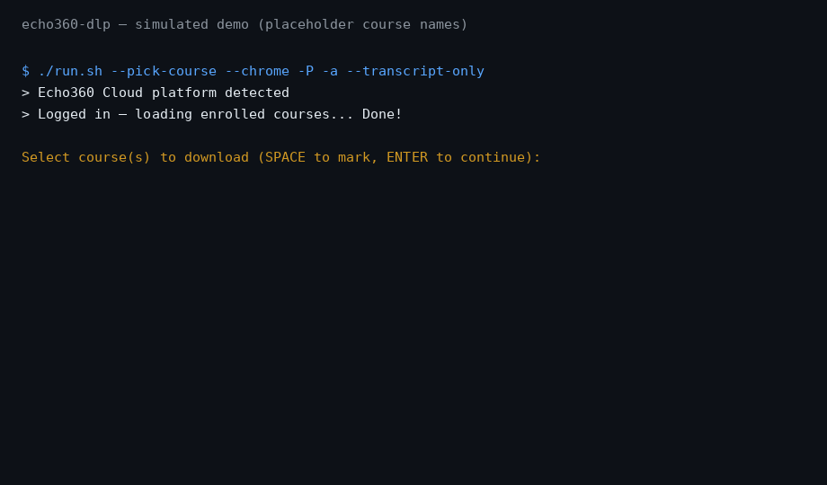

# echo360-dlp — Quick Start

**Windows:** `.\run.bat` · **macOS / Linux:** `./run.sh`  
Full guide (TUI keys, every flag): **[USAGE.md](USAGE.md)**

> Personal study only — do not redistribute recordings.

```bash
git clone https://github.com/tuyoik/echo360-dlp.git
cd echo360-dlp
```

---

## Probably the only command you need to run

> [!TIP]
> **This is probably all you need** — the recipes below are for special cases.

**Windows** (PowerShell):

```powershell
.\run.bat --pick-course --chrome --setup-credentials -P -a
```

**macOS / Linux** (Terminal):

```bash
./run.sh --pick-course --chrome --setup-credentials -P -a
```

Setup happens automatically on first run (venv + dependencies), then the command runs with your flags.

<p align="center">
    
</p>

How the login goes: enter your **Echo360 login email** once (find it in Echo360 → **Settings**, account/profile) — it's **typed into the Echo360 page for you**. Authenticate with your university SSO in Chrome, and echo360-dlp **detects the login automatically** — nothing more to type until the course picker.

Same command, but **transcripts only** (no MP4):

```powershell
.\run.bat --pick-course --chrome -P -a --transcript-only
```

```bash
./run.sh --pick-course --chrome -P -a --transcript-only
```

### TUI keys

| Key | Action |
|-----|--------|
| **↑ / ↓** | Move |
| **SPACE** | Mark / unmark |
| **ENTER** | Confirm (≥ 1 marked) |

- **`--pick-course`** → course list (`CODE - Name (N streams, M lessons)`)
- **`-i`** → lecture list for the current section/stream
- You can use **both**: courses first, then lectures per stream

---

## Recipes

### Multi-course TUI (video + transcripts, all streams)

```powershell
.\run.bat --pick-course --chrome --setup-credentials -P
```

```bash
./run.sh --pick-course --chrome --setup-credentials -P
```

### Multi-course TUI + dual stream + transcripts only

```powershell
.\run.bat --pick-course --chrome -P -a --transcript-only
```

```bash
./run.sh --pick-course --chrome -P -a --transcript-only
```

### Multi-course TUI + dual stream + video only

```powershell
.\run.bat --pick-course --chrome -P -a --video-only
```

```bash
./run.sh --pick-course --chrome -P -a --video-only
```

### Section URL — video + transcripts (default)

```powershell
.\run.bat "https://echo360.net.au/section/YOUR-SECTION-UUID/home" --chrome -P
```

```bash
./run.sh "https://echo360.net.au/section/YOUR-SECTION-UUID/home" --chrome -P
```

### Just transcripts / just video (one course)

```powershell
.\run.bat "YOUR-COURSE-URL" --chrome -P --transcript-only
.\run.bat "YOUR-COURSE-URL" --chrome -P --video-only
```

```bash
./run.sh "YOUR-COURSE-URL" --chrome -P --transcript-only
./run.sh "YOUR-COURSE-URL" --chrome -P --video-only
```

### Dual stream (`-a`)

```powershell
.\run.bat "YOUR-COURSE-URL" --chrome -P -a
```

```bash
./run.sh "YOUR-COURSE-URL" --chrome -P -a
```

### Lecture TUI (`-i`)

```powershell
.\run.bat "YOUR-COURSE-URL" --chrome -P -i
.\run.bat "YOUR-COURSE-URL" --chrome -P -i -a
.\run.bat "YOUR-COURSE-URL" --chrome -P -i --transcript-only
```

```bash
./run.sh "YOUR-COURSE-URL" --chrome -P -i
./run.sh "YOUR-COURSE-URL" --chrome -P -i -a
./run.sh "YOUR-COURSE-URL" --chrome -P -i --transcript-only
```

### Course TUI then lecture TUI

```powershell
.\run.bat --pick-course --chrome -P -i -a
```

```bash
./run.sh --pick-course --chrome -P -i -a
```

### Dates / short names / custom folder

```powershell
.\run.bat "YOUR-COURSE-URL" --chrome -P --after-date "2026-03-01" --before-date "2026-06-30"
.\run.bat --pick-course --chrome -P -a --short-names
.\run.bat "YOUR-COURSE-URL" --chrome -P -o "C:\Lectures"
```

```bash
./run.sh "YOUR-COURSE-URL" --chrome -P --after-date "2026-03-01" --before-date "2026-06-30"
./run.sh --pick-course --chrome -P -a --short-names
./run.sh "YOUR-COURSE-URL" --chrome -P -o "$HOME/Lectures"
```

### Legacy USYD-style portal

```powershell
.\run.bat "https://view.streaming.sydney.edu.au:8443/ess/portal/section/041698d6-f43a-4b09-a39a-b90475a63530" --chrome
```

---

## Flag cheat sheet

| Flag | What it does |
|------|----------------|
| `--pick-course` | Course TUI (Cloud enrollments; all streams per course) |
| `-i` / `--interactive` | Lecture TUI |
| `-a` / `--alternative_feeds` | Both video feeds |
| `--transcript-only` | `.vtt` only (no MP4) |
| `--video-only` | MP4 only (no `.vtt`) |
| `-P` / `--persistent-session` | Remember Chrome login |
| `--setup-credentials` | Open browser for SSO; asks for Echo360 email (find it in Echo360 **Settings**) |
| `--chrome` | Chrome WebDriver (recommended) |
| `--firefox` | Firefox WebDriver |
| `--stealth` | Stealth Chrome (bot / FIDO) |
| `--short-names` | `Lecture 01` paths under `by_lecture/` |
| `-o PATH` | Output folder (must exist) |
| `--after-date` / `--before-date` | Date filter |
| `--manual` | Type `continue` after SSO |
| `--debug` | Verbose logs |
| `--echo360cloud` | Force Cloud mode |

`--video-only` and `--transcript-only` cannot be used together.

---

## Output

```text
_local/downloads/…/mp4/*.mp4
_local/downloads/…/transcript/*.vtt
```

With `-a`, dual feeds become `Lecture 01.1.mp4` / `Lecture 01.2.mp4` (or `…1` / `…2` suffixes on long names).

---

## Troubleshooting

| Issue | Fix |
|-------|-----|
| PowerShell | Use `.\run.bat` |
| Login hangs | Finish SSO; try `--manual` |
| Want both cameras | Add `-a` |
| Windows path too long | `--short-names` |
| Chrome `-P` crash | Delete `_local/browser_session/` |
