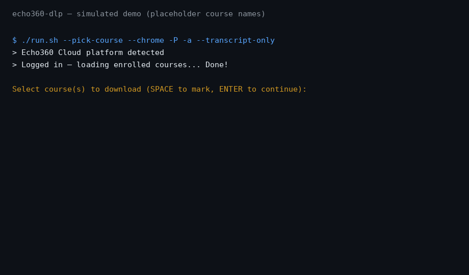
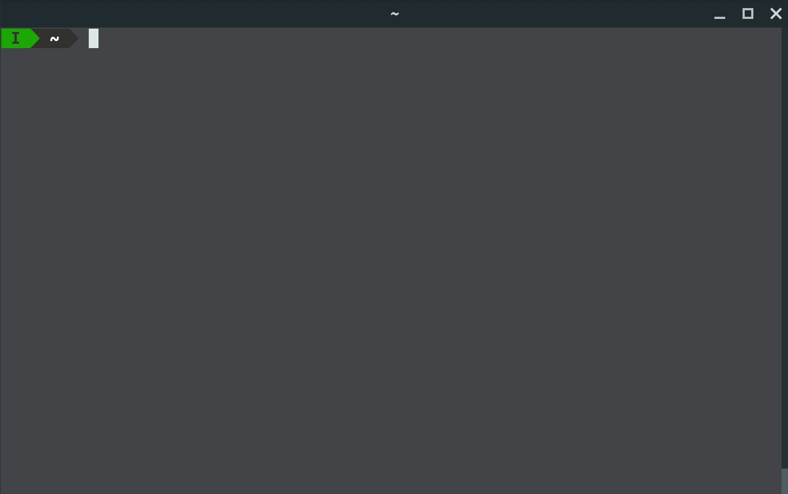
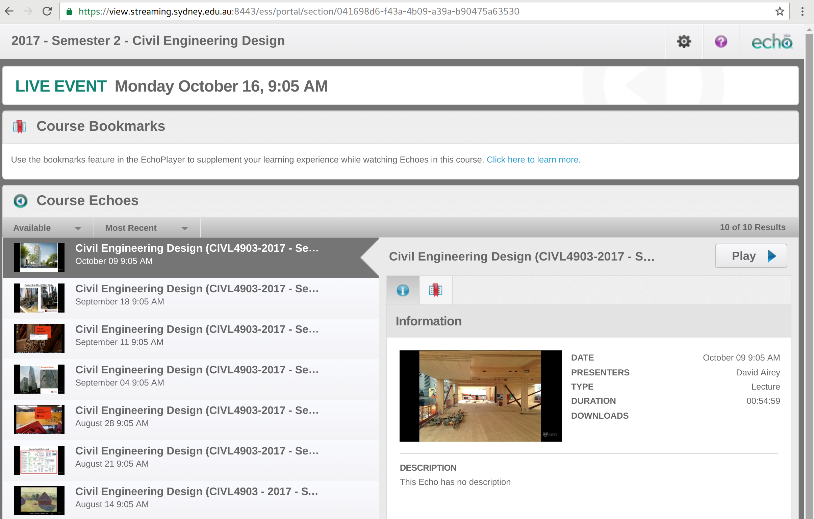
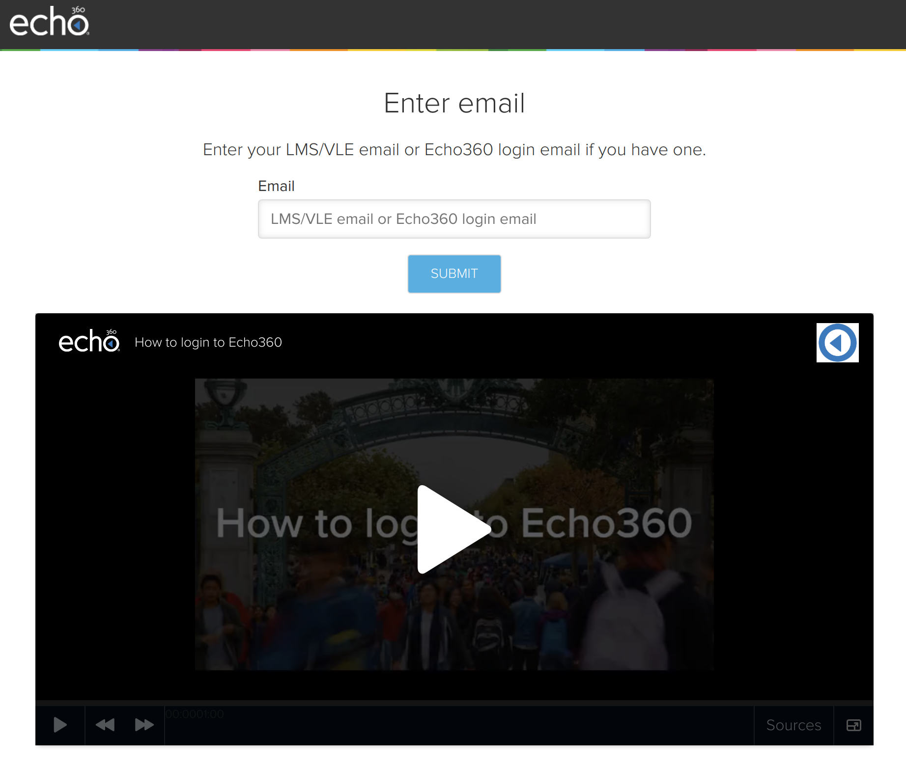
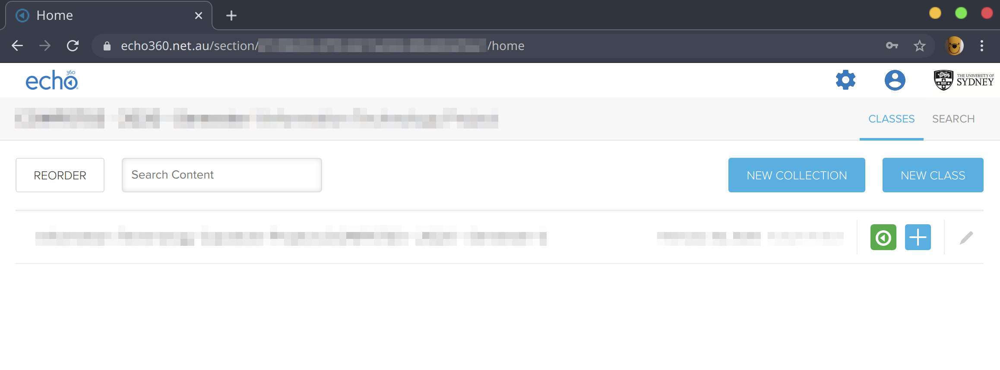
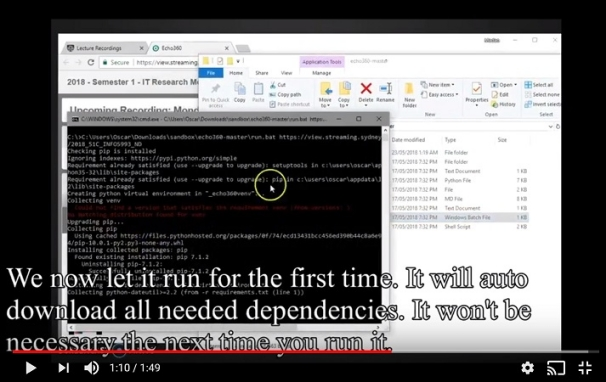
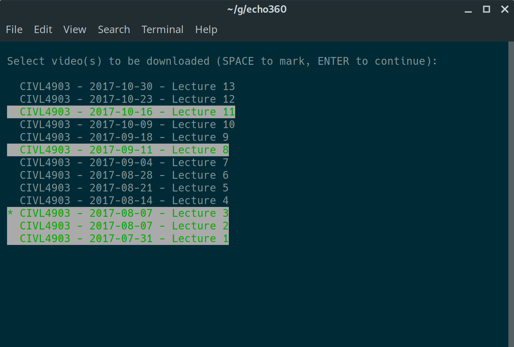

# echo360-dlp

**echo360-dlp** is an **Echo360 downloader** — batch-download lecture videos and **VTT transcripts / captions** from **Echo360 Cloud** (`echo360.org` / `echo360.net.au`) and university Echo360 portals, for offline study. One-command setup on **Windows, macOS, and Linux**, SSO login via Chrome, and captions saved next to every MP4.

**Repository:** [github.com/tuyoik/echo360-dlp](https://github.com/tuyoik/echo360-dlp)  
**Maintainer:** Andrew Zhu ([@tuyoik](https://github.com/tuyoik))

**Start here:** **[QUICKSTART.md](QUICKSTART.md)** · **Full guide (TUI + every flag):** **[USAGE.md](USAGE.md)** · **Policy:** [ACCEPTABLE_USE.md](ACCEPTABLE_USE.md)

## Probably the only command you need to run

> [!TIP]
> **The command below is probably all you need.** Everything after this section is reference — you don't have to read it to get your lectures.

Copy the line for your system and run it inside the project folder:

**Windows** (PowerShell):

```powershell
.\run.bat --pick-course --chrome --setup-credentials -P -a
```

**macOS / Linux** (Terminal):

```bash
./run.sh --pick-course --chrome --setup-credentials -P -a
```

There are no install steps — the launcher **sets everything up on first run** (its own Python environment + dependencies) and then runs with the flags above.

What you'll see:

1. It asks for your **Echo360 login email** — copy it from Echo360 → **Settings** (account/profile). Saved for next time.
2. Chrome opens and **your email is typed into the Echo360 login page for you**.
3. **Log in with your university SSO** — that's the only manual step. Once you're in, echo360-dlp **detects the login by itself**; nothing more to type.
4. A **course picker** appears in the terminal: **↑↓** move, **SPACE** to tick courses, **ENTER** to start.
5. Everything downloads — **MP4s (both camera feeds when a lecture has two) plus `.vtt` subtitles**, organized under `_local/downloads/`.

Run it again anytime — already-downloaded lectures are skipped, and `-P` keeps you logged in.

<p align="center">
    
</p>

Only want subtitles (no video)? Same command plus `--transcript-only`:

```powershell
.\run.bat --pick-course --chrome -P -a --transcript-only
```

```bash
./run.sh --pick-course --chrome -P -a --transcript-only
```

More combos: [QUICKSTART.md](QUICKSTART.md) · TUI details: [USAGE.md — How TUI modes work](USAGE.md#how-tui-modes-work).

## Acceptable use

**Personal study only.** If Echo360 already lets you watch a lecture, this tool **batch-downloads** videos and transcripts you could save manually (separately, one-by-one in the browser). **Do not redistribute** recordings. Details: **[ACCEPTABLE_USE.md](ACCEPTABLE_USE.md)**.

## Fork

**echo360-dlp** is a maintained fork of [soraxas/echo360](https://github.com/soraxas/echo360) (MIT). The upstream project is © 2017–2023 Tin Lai ([@soraxas](https://github.com/soraxas)); this fork © 2026 Andrew Zhu ([@tuyoik](https://github.com/tuyoik)). See [LICENSE](LICENSE).

Additions and changes in this fork include:

- Echo360 Cloud **course picker** (`--pick-course`) and enrolled-courses API
- **Lecture TUI** (`-i`) and **dual feeds** (`-a`)
- **VTT subtitles** — separate `.vtt` files plus soft subs muxed into MP4
- **`--video-only` / `--transcript-only`** — download MP4 or VTT without the other
- **`_local/` layout** — downloads, logs, browser session, and venv in one gitignored folder
- **Selenium 4 / Chrome** as the supported path (PhantomJS legacy retained but not recommended)

### Features

- **Video download** — HLS and MP4 from Echo360 Cloud and university Echo360 portals
- **VTT subtitles** — When a lecture has captions, a `.vtt` file is saved next to the `.mp4` (VLC loads it automatically when filenames match)
- **Cross-platform launchers** — `run.bat` (Windows), `run.sh` (macOS/Linux)
- **Local data in `_local/`** — downloads, logs, browser session, and venv live in one folder (not mixed with the project)
- **Echo360 Cloud SSO** — Log in once with `--chrome --setup-credentials`
- **Persistent session** — `-P` keeps login in `_local/browser_session`
- **Course TUI** — `--pick-course` lists enrolled courses (multiselect) and downloads all streams
- **Lecture TUI** — `-i` pick individual lectures
- **Dual stream** — `-a` downloads both video feeds when available
- **Media modes** — `--video-only` or `--transcript-only`
- **Date filters / short names / custom output** — `--after-date`, `--before-date`, `--short-names`, `-o`

### Quick start (all platforms)

**Windows**

```powershell
.\run.bat --pick-course --chrome --setup-credentials -P -a
```

**macOS / Linux**

```bash
./run.sh --pick-course --chrome --setup-credentials -P -a
```

Or with a **section home** URL (lists all lectures in one stream):

```text
https://echo360.net.au/section/YOUR-SECTION-UUID/home
```

Use the **course page** URL (`.../section/UUID/home`), not a single `/lesson/.../classroom` link. More recipes: **[QUICKSTART.md](QUICKSTART.md)** · flag/TUI reference: **[USAGE.md](USAGE.md)**.

---

The FAQ below covers all platforms and options. Much of it comes from the upstream [echo360](https://github.com/soraxas/echo360) documentation and still applies to echo360-dlp.

echo360-dlp is a command-line Python tool that downloads lecture videos from university Echo360 portals and Echo360 Cloud. You need a course or section URL (or `--pick-course` on Cloud). See the FAQ for details.

See it in action (original upstream demo):

<p align="center">
    
</p>

**NEWS:** It now works with `echo360.org` platform as well. Special thanks to [*@cloudrac3r*](https://github.com/cloudrac3r) and *Emma* for their kind offering of providing sources and helped debugging it. Read [FAQ](#echo360-cloud) for details.

# Getting Started

### Automated Installation

**Linux / MacOS**

```shell
./run.sh COURSE_URL  # where COURSE_URL is your course url
```

**Windows**

```shell
run.bat COURSE_URL  # where COURSE_URL is your course url
```

The scripts will boostrap all installation and download all needed files on the fly.

**pip** (from this repo)

```shell
pip install git+https://github.com/tuyoik/echo360-dlp.git
echo360-dlp COURSE_URL
```

Or from a local clone: `pip install .` then `echo360-dlp COURSE_URL`.

### Optional

-   ffmpeg (for transcoding ts file to mp4 file) See [here (windows)](https://www.easytechguides.com/install-ffmpeg/) or [here](https://github.com/adaptlearning/adapt_authoring/wiki/Installing-FFmpeg) for a brief instructions of installing it in different OS.

## Manual

The provided script automated every operations, and install all dependency in a local python virtual environment. You can also use the system-wise python installation by manual installation. Get started by first install all requirements:

```shell
pip install -r requirements.txt  # or with: python -m pip install -r requirements.txt
```

Then run with:

```shell
python echo360.py
```

### Operating System

-   Linux
-   OS X
-   Windows

# Usage

**NOTE THAT** all the below command you can substitute `python echo360.py` with `./run.sh` (or `run.bat` if you are in windows)

### Quick Start

```shell
>>> python echo360.py                       \
    https://view.streaming.sydney.edu.au:8443/ess/portal/section/2018_S1C_INFO1001_ND
```

### Script args

Full reference (TUI keys + every flag): **[USAGE.md](USAGE.md)**. Summary of current flags:

```text
usage: echo360.py [-h] [--output OUTPUT_PATH]
                  [--after-date AFTER_DATE] [--before-date BEFORE_DATE]
                  [--unikey UNIKEY] [--password PASSWORD]
                  [--setup-credentials] [--persistent-session]
                  [--download-phantomjs-binary] [--stealth]
                  [--chrome] [--firefox] [--echo360cloud]
                  [--pick-course] [--interactive] [--alternative_feeds]
                  [--short-names] [--video-only | --transcript-only]
                  [--debug] [--auto | --manual]
                  [ECHO360_URL]

  ECHO360_URL              Section/course URL or UUID (optional with --pick-course)
  -o, --output             Output folder (must exist); default _local/downloads
  --after-date / --before-date   Date filters (YYYY-MM-DD)
  -u / -p                  Legacy USYD unikey/password (prefer SSO)
  --setup-credentials      Open browser for SSO login
  -P, --persistent-session Keep Chrome session in _local/browser_session
  --chrome / --firefox / --stealth   Browser drivers
  --pick-course            Course TUI (Cloud enrollments; all streams)
  -i, --interactive        Lecture TUI (SPACE mark, ENTER confirm)
  -a, --alternative_feeds  Download both video feeds
  --short-names            Lecture 01… under by_lecture/
  --video-only             MP4 only (no .vtt)
  --transcript-only        .vtt only (no MP4)
  --debug / --auto / --manual
```

# Examples

Preferred: see **[USAGE.md](USAGE.md)** (examples first) and **[QUICKSTART.md](QUICKSTART.md)**.

```shell
>>> python echo360.py                  \
    "041698d6-f43a-4b09-a39a-b90475a63530" \  # Note this default to USYD's echo360
    --output "~/Lectures"                     # Use full URL for other University
```

### Download all available lectures

```shell
>>> python echo360.py                  \
    "041698d6-f43a-4b09-a39a-b90475a63530" \
    --output "~/Lectures"
```

### Download all lectures on or before a date

```shell
>>> python echo360.py                  \
    "041698d6-f43a-4b09-a39a-b90475a63530" \
    --output "~/Lectures"                  \
    --before-date "2014-10-14"
```

### Download all lectures on or after a date

```shell
>>> python echo360.py                  \
    "041698d6-f43a-4b09-a39a-b90475a63530" \
    --output "~/Lectures"                  \
    --after-date "2014-10-14"
```

### Download all lectures in a given date range (inclusive)

```shell
>>> python echo360.py                  \
    "041698d6-f43a-4b09-a39a-b90475a63530" \
    --output "~/Lectures"                  \
    --after-date "2014-08-26"              \
    --before-date "2014-10-14"
```

### Use chrome driver (instead of phantomjs)

Note: sometime it works better than phantomjs in some system

```shell
>>> python echo360.py                  \
    "041698d6-f43a-4b09-a39a-b90475a63530" \
    --chrome
```

# FAQ

### Is my university supported?

This is first built for the echo system in the University of Sydney, and then validated in several other universities' echo system. In theory, as long as the url are in the format of:

```shell
https://$(hostname)/ess/portal/section/$(UUID)
```
or
```shell
https://echo360.org[.xx]/
```
or with a dot net variant
```shell
https://echo360.net[.xx]/
```

... then it should be supported.

The variables `$(hostname)` and `$(UUID)` are what differentiate different University's echo360 system. If there is no credentials needed (ie no need to login before accessing the page), then 90% of the time it should works. If login is needed, some extra work might need to be put in before it works for your university. If that is the case, create an issue to let me know.

As for `echo360.org`, see [this](#echo360-cloud).

### How do I retrieve the Course URL for a course?

You should go to the main Echo360 Lecture page, which usually composed of all the lecturer recordings in a list format as shown below. It's the main page that lists all the recorded lectures and gives you the option to stream them or download them individually. This is important for downloading all the available videos from within the course.



You can usually find this link on your course's main webpage. If your course webpage only links directly to videos, then you should be able to navigate back **by clicking the title of your course name (top of page)**.

The URL for the University of Sydney - 2017 semester 2 of CIVL4903 looks like

    https://view.streaming.sydney.edu.au:8443/ess/portal/section/041698d6-f43a-4b09-a39a-b90475a63530

which you can verify is correct in the above screenshot. **This should be the full URL you enter into the script, for all other universities' echo system.**

The UUID (Unified Unique IDentifier) is the last element of the URL. So in the above example it's,

    041698d6-f43a-4b09-a39a-b90475a63530

### echo360 cloud

Echo360 cloud refers to websites in the format of `https://echo360.org[.xx]`. This module now officially support this platform.

<p align="center">

</p>

This method requires you to setup SSO credentials, therefore, it needs to open up a browser for you to setup your own university's SSO credentials.

To download videos, run:
```shell
./run.sh https://echo360.<org|net>[.xx]/section/$(UUID)/home
```
where `[.xx]` is an optional country flag specific to your echo360 platform and `$(UUID)` is the unique identifier for your course. This should the url that you can retrieve from your course's *main page* like the following.



Note that this implies `setup-credential` option and will use chrome-webdriver by default. If you don't have chrome or prefer to use firefox, run it with the ` --firefox` flag like so:
```shell
./run.sh https://echo360.<org|net>[.xx]/section/$(UUID)/home --firefox
```

After running the command, it will opens up a browser instance, most likely with a login page. You should then login with your student's credentials like what you would normally do. After you have successfully logged in, the module should automatically redirects you and continues. If the script hangs (e.g. failed to recognises that you have logged in), feel free to let me know.


### I'm not sure of how to run it?

Start with **[QUICKSTART.md](QUICKSTART.md)** (Windows, macOS, Linux). Install [Python](https://www.python.org/downloads/) if needed, then use `run.bat` / `run.sh`.

Windows walkthrough (upstream, still useful for finding a course URL):

- For [Windows users](https://www.youtube.com/watch?v=Lv1wtjnCcwI) (shows how to retrieve the Echo360 course URL)
[](https://www.youtube.com/watch?v=Lv1wtjnCcwI)

### My credentials does not work?

You can setup any credentials need with manually logging into websites, by running the script with:
```sh
./run.sh ECHO360_URL --setup-credentials
```
This opens Chrome so you can log in as usual. For Echo360 Cloud it also asks for your **login email** — copy it from Echo360 → **Settings** (account / profile) so the “Enter email” page is filled with the right address. Afterwards, if needed, type `continue` in the terminal.

### My credentials does not work (echo360.org)?

For echo360.org, the default behaviour is it will always require you to setup-credentials, and the module will automatically detect login token and proceed the download process. For some institutions, this seems to be not sufficient (#29).

You can disable such behaviour with
```sh
./run.sh ECHO360_ORG_URL --manual
```
for manual setup; and once you had logged in, type
```sh
continue
```
in your terminal to continue.

### How do I download only individual video(s)?

Use the **lecture TUI** (`-i` / `--interactive`):

```sh
./run.sh ECHO360_URL --chrome -P -i
```

**SPACE** to mark lectures, **ENTER** to confirm:



### How do I pick courses from my enrollment list?

Echo360 Cloud only — **course TUI**:

```sh
./run.sh --pick-course --chrome --setup-credentials -P -a
```

Rows look like `CODE - Name (N streams, M lessons)`. Mark with **SPACE**, confirm with **ENTER**. Every stream for each selected course downloads. Combine with `-i` to also pick lectures, `-a` for dual feeds, `--transcript-only` / `--video-only` for media mode. See [USAGE.md](USAGE.md#how-tui-modes-work).

### My lecture has two video feeds, how can I download both of them?

Add `--alternative_feeds` or `-a`. Filenames get a feed suffix (`…1` / `…2` or `Lecture 01.1` / `Lecture 01.2` with `--short-names`).

### How do I download only transcripts or only video?

```sh
./run.sh ECHO360_URL --chrome -P --transcript-only   # .vtt only
./run.sh ECHO360_URL --chrome -P --video-only        # MP4 only
```

These two flags are mutually exclusive. Default (neither flag) downloads **both** and muxes soft subs into the MP4 when ffmpeg is available.

### Technical details

The current script uses a web-driver to emulate as a web-browser in order to retrieve the original streaming link. There are current two options for the web-driver: PhantomJS and Chrome. It then uses a hls downloader to simultaneously download all the smaller parts of the videos, and combined into one. Transcoding into mp4 will be performed if ffmpeg is present in your system, and all files will be renamed into a nice format.

# License & credits

**echo360-dlp** is maintained by Andrew Zhu ([@tuyoik](https://github.com/tuyoik)) and licensed under the [MIT License](LICENSE) (source code only).

**Downloaded lectures:** personal use only — redistribution is **prohibited**. See [ACCEPTABLE_USE.md](ACCEPTABLE_USE.md).

It is a fork of [echo360](https://github.com/soraxas/echo360) by Tin Lai ([@soraxas](https://github.com/soraxas)), © 2017–2023.

Upstream credits: [jhalstead85/lecho360](https://github.com/jhalstead85/lecho360) (original basis), extended for USYD Echo360, Canvas, and multi-university use before the Cloud fork work in echo360-dlp.
