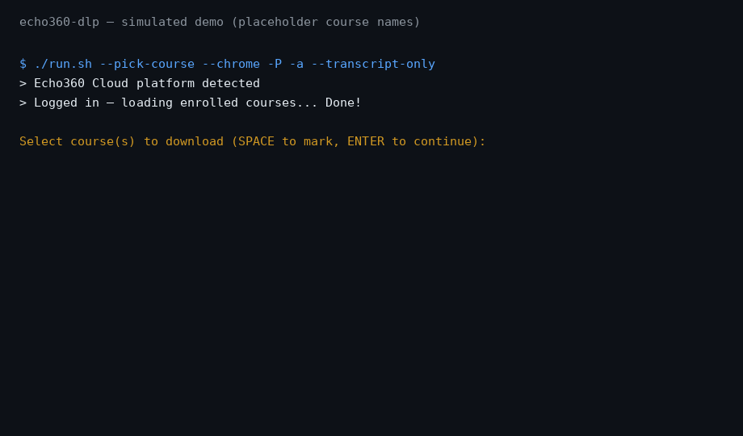
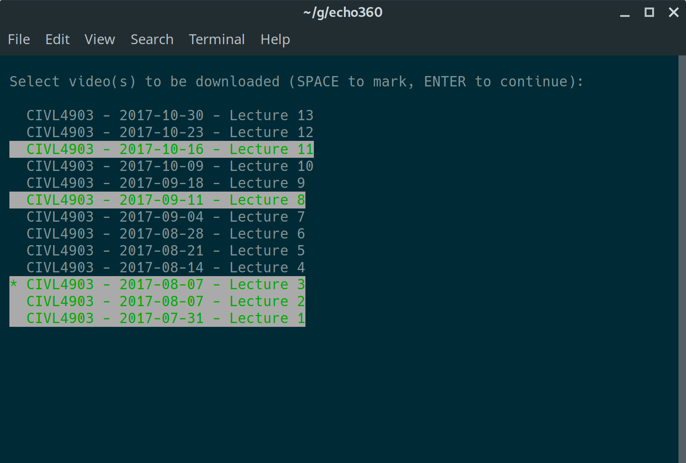
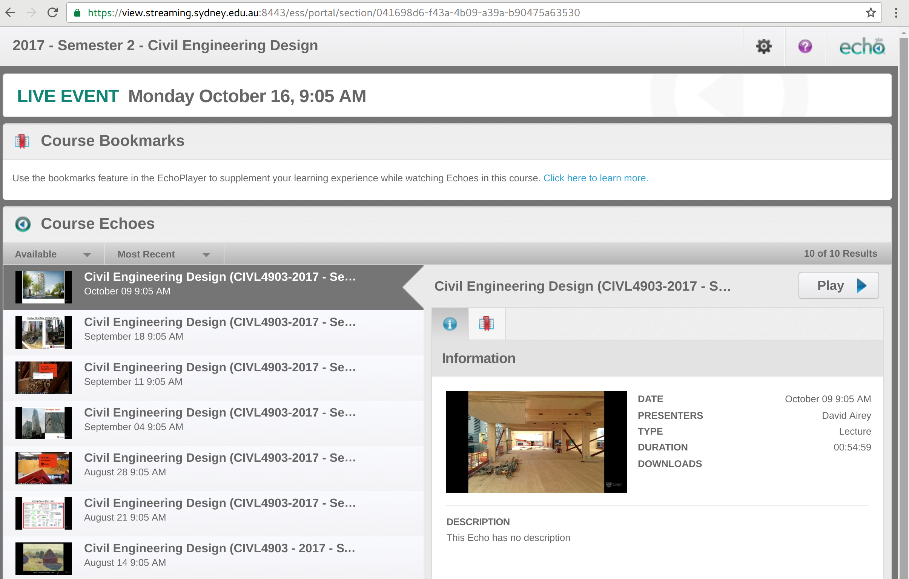

# echo360-dlp — Usage Guide

**Repo:** [github.com/tuyoik/echo360-dlp](https://github.com/tuyoik/echo360-dlp) · **Maintainer:** Andrew Zhu ([@tuyoik](https://github.com/tuyoik))  
Quick recipes: **[QUICKSTART.md](QUICKSTART.md)** · Policy: **[ACCEPTABLE_USE.md](ACCEPTABLE_USE.md)**

> **Personal study only.** Download lectures you can already open on Echo360. **Do not redistribute** recordings.

---

## Probably the only command you need to run

> [!TIP]
> **This one command is probably all you need** — the rest of this guide is reference for special cases.

**Windows** (PowerShell):

```powershell
.\run.bat --pick-course --chrome --setup-credentials -P -a
```

**macOS / Linux** (Terminal):

```bash
./run.sh --pick-course --chrome --setup-credentials -P -a
```

The launcher **runs setup automatically if it hasn't already** (creates `_local/venv`, installs dependencies), then runs with the flags you gave it.

<p align="center">
    
</p>

What happens:

1. It asks for your **Echo360 login email** (or confirms a saved one). Copy it from Echo360 → **Settings** (account / profile) — that exact address.
2. Chrome opens and **the email is entered into the Echo360 login page automatically**.
3. You **authenticate with your university SSO** — the only manual step. Afterwards echo360-dlp **detects the login by itself**; no further input needed until the course picker.
4. **Course TUI** lists enrolled courses → **SPACE** to mark, **ENTER** to confirm.
5. Every recording stream for each selected course downloads: `.mp4` under `mp4/`, `.vtt` under `transcript/` (when captions exist).
6. `-a` also grabs the **second video feed** when Echo360 publishes two (e.g. presenter + slides).

Re-running skips already-downloaded lectures; `-P` keeps you logged in.

Transcripts only (no MP4), same TUI + dual-feed resolution:

```powershell
.\run.bat --pick-course --chrome -P -a --transcript-only
```

```bash
./run.sh --pick-course --chrome -P -a --transcript-only
```

---

## How TUI modes work

There are **two interactive pickers** (TUIs). Both use the same keys.

### Keys (all TUIs)

| Key | Action |
|-----|--------|
| **↑ / ↓** | Move cursor |
| **SPACE** | Toggle mark on the highlighted row |
| **ENTER** | Confirm selection (needs ≥ 1 marked) |



### 1. Course TUI — `--pick-course` (Echo360 Cloud only)

Lists courses from `/user/enrollments` after SSO. Each row looks like:

```text
MATH1251 - Maths - Actuarial & Finance 1B (2 streams, 24 lessons)
```

- Mark one or more courses with **SPACE**, then **ENTER**
- Downloads **all recording streams** for every marked course
- No section URL required (optional bootstrap URL is ignored for picking)

Also uses a small **email confirm TUI** if you previously saved a login email (`↑↓` + **ENTER**): *Use saved* vs *Enter a different email*.

**Where to find the email:** open Echo360 in a browser → **Settings** (or account / profile). Copy the Echo360 / LMS login email shown there. That is the address `--setup-credentials` should use so the Cloud login form is filled correctly.

### 2. Lecture TUI — `-i` / `--interactive`

After the course/section is known, lists each lecture (and multipart pieces) so you can mark which ones to download:

```text
Select video(s) to be downloaded (SPACE to mark, ENTER to continue):
```

Works with a section URL **or** together with `--pick-course` (you pick courses first, then lectures inside each stream).

### Combining TUIs with other flags

| Goal | Command shape |
|------|----------------|
| Multi-course, video + transcripts, dual feed | `--pick-course -P -a` |
| Multi-course, **transcripts only**, dual feed | `--pick-course -P -a --transcript-only` |
| Multi-course, **video only**, dual feed | `--pick-course -P -a --video-only` |
| One course URL, pick lectures | `"URL" -P -i` |
| Pick lectures + dual feed | `"URL" -P -i -a` |
| Courses then lectures | `--pick-course -P -i` |
| Courses then lectures + dual + transcripts only | `--pick-course -P -i -a --transcript-only` |

---

## Getting started

```bash
git clone https://github.com/tuyoik/echo360-dlp.git
cd echo360-dlp
```

| Platform | Launcher | Notes |
|----------|----------|-------|
| **Windows** | `.\run.bat` | PowerShell needs `.\` |
| **macOS / Linux** | `./run.sh` | Auto-detects `python3` |

First run creates `_local/venv` and installs dependencies. Install **ffmpeg** on PATH so HLS/TS converts to MP4 and soft subs can mux.

### Recommended first Cloud run

```powershell
.\run.bat --pick-course --chrome --setup-credentials -P
```

```bash
./run.sh --pick-course --chrome --setup-credentials -P
```

### Or with a section home URL

Use the page that **lists all lectures**, not a single classroom link:

```text
https://echo360.net.au/section/YOUR-SECTION-UUID/home
```

```powershell
.\run.bat "https://echo360.net.au/section/YOUR-SECTION-UUID/home" --chrome --setup-credentials -P
```

```bash
./run.sh "https://echo360.net.au/section/YOUR-SECTION-UUID/home" --chrome --setup-credentials -P
```

---

## Features (what the code supports)

| Feature | How |
|---------|-----|
| Echo360 Cloud + university portals | Cloud URL / `--echo360cloud` / legacy `/ess/portal/section/…` |
| SSO login in Chrome | `--chrome --setup-credentials` (and usually `-P`) |
| Persistent browser session | `-P` → `_local/browser_session/` |
| Course picker (multi-course) | `--pick-course` |
| Lecture picker | `-i` |
| Dual video feeds | `-a` / `--alternative_feeds` |
| Video + VTT (default) | no extra flag; VTT muxed into MP4 when possible |
| Video only | `--video-only` |
| Transcripts only | `--transcript-only` |
| Date filters | `--after-date` / `--before-date` |
| Short Windows-friendly names | `--short-names` |
| Custom output root | `-o PATH` (folder must exist) |
| Stealth Chrome | `--stealth` |
| Firefox | `--firefox` |
| Manual continue after SSO | `--manual` (type `continue`) |
| Resume / backfill missing VTTs | re-run same command; existing MP4s skipped, missing `.vtt` fetched |
| Local layout | `_local/{venv,downloads,logs,browser_session}` |
| Ctrl+C cancel | once to cancel gracefully; twice to force quit |

`--video-only` and `--transcript-only` are **mutually exclusive**.

---

## More examples

### Just transcripts (one section)

```powershell
.\run.bat "YOUR-COURSE-URL" --chrome -P --transcript-only
```

```bash
./run.sh "YOUR-COURSE-URL" --chrome -P --transcript-only
```

### Just video (one section)

```powershell
.\run.bat "YOUR-COURSE-URL" --chrome -P --video-only
```

```bash
./run.sh "YOUR-COURSE-URL" --chrome -P --video-only
```

### Dual stream only (both feeds, default media)

```powershell
.\run.bat "YOUR-COURSE-URL" --chrome -P -a
```

```bash
./run.sh "YOUR-COURSE-URL" --chrome -P -a
```

### Lecture TUI + dual stream + transcripts only

```powershell
.\run.bat "YOUR-COURSE-URL" --chrome -P -i -a --transcript-only
```

```bash
./run.sh "YOUR-COURSE-URL" --chrome -P -i -a --transcript-only
```

### Course TUI + lecture TUI + dual stream

```powershell
.\run.bat --pick-course --chrome --setup-credentials -P -i -a
```

```bash
./run.sh --pick-course --chrome --setup-credentials -P -i -a
```

### Date range

```powershell
.\run.bat "YOUR-COURSE-URL" --chrome -P --after-date "2026-03-01" --before-date "2026-06-30"
```

```bash
./run.sh "YOUR-COURSE-URL" --chrome -P --after-date "2026-03-01" --before-date "2026-06-30"
```

### Short names (Windows long-path friendly)

```powershell
.\run.bat --pick-course --chrome -P -a --short-names
```

```bash
./run.sh --pick-course --chrome -P -a --short-names
```

### Custom output folder (must already exist)

```powershell
.\run.bat "YOUR-COURSE-URL" --chrome -P -o "C:\Lectures"
```

```bash
./run.sh "YOUR-COURSE-URL" --chrome -P -o "$HOME/Lectures"
```

### Legacy university portal (USYD-style example)

```powershell
.\run.bat "https://view.streaming.sydney.edu.au:8443/ess/portal/section/041698d6-f43a-4b09-a39a-b90475a63530" --chrome
```

```bash
./run.sh "041698d6-f43a-4b09-a39a-b90475a63530" --chrome
```

UUID-only defaults to the University of Sydney hostname — use a **full URL** for other universities.

### Manual SSO continue

```powershell
.\run.bat "YOUR-COURSE-URL" --chrome --setup-credentials --manual
```

Log in in the browser, then type `continue` in the terminal.

### Stealth Chrome (bot detection / FIDO)

```powershell
.\run.bat "YOUR-COURSE-URL" --stealth --setup-credentials -P
```

### Debug logging

```powershell
.\run.bat "YOUR-COURSE-URL" --chrome -P --debug
```

---

## Finding your course URL

Use the **main page that lists all recordings**.

| Platform | URL shape |
|----------|-----------|
| University Echo360 | `https://$(hostname)/ess/portal/section/$(UUID)` |
| Echo360 Cloud | `https://echo360.org/section/$(UUID)/home` or `https://echo360.net.au/section/$(UUID)/home` |



Example:

```text
https://view.streaming.sydney.edu.au:8443/ess/portal/section/041698d6-f43a-4b09-a39a-b90475a63530
```

Do **not** use a single `/lesson/.../classroom` link — the tool will reject it and tell you to open the section home.

---

## Output layout

Default:

```text
_local/downloads/
  MATH1251 - Maths - Actuarial & Finance 1B/
    2026T2 Lecture A/
      mp4/
        2026-05-31 - Lecture 1 [...].mp4
      transcript/
        2026-05-31 - Lecture 1 [...].vtt
```

With `--short-names`:

```text
_local/downloads/by_lecture/
  COMP3231_COMP3891_COMP9201_COMP9283/
    mp4/
      Lecture 01.mp4
      Lecture 01.2.mp4   ← second feed when using -a
    transcript/
      Lecture 01.vtt
```

Dual feed (`-a`) appends `1` / `2` to filenames when both feeds download.

### `_local/` (gitignored — never commit)

| Path | Purpose |
|------|---------|
| `venv/` | Python environment |
| `downloads/` | Videos + transcripts |
| `logs/` | Downloader / webdriver logs |
| `browser_session/` | Chrome profile for `-P` |
| `echo360_login_email.txt` | Saved login email hint |

---

## Complete flag reference

Matches `./run.sh --help` / `.\run.bat --help`.

### Positional

| Arg | Description |
|-----|-------------|
| `ECHO360_URL` | Section/course URL, or UUID (USYD default host). **Optional** with `--pick-course`. |

### Output & filtering

| Flag | Short | Description |
|------|-------|-------------|
| `--output PATH` | `-o` | Output directory (**must exist**). Default: `_local/downloads`. |
| `--after-date YYYY-MM-DD` | | Only lectures on/after this date. |
| `--before-date YYYY-MM-DD` | | Only lectures on/before this date. |
| `--interactive` | `-i` | **Lecture TUI** — mark lectures with SPACE, confirm with ENTER. |

### Authentication & session

| Flag | Short | Description |
|------|-------|-------------|
| `--unikey UNIKEY` | `-u` | Legacy USYD unikey (prefer SSO). |
| `--password PASSWORD` | `-p` | Legacy USYD password (prefer SSO; never commit). |
| `--setup-credentials` | | Open browser to log in (implies Chrome on Cloud). Prompts for Echo360 login email (see **Settings** in Echo360) so the email page can be filled correctly. |
| `--persistent-session` | `-P` | Reuse Chrome profile under `_local/browser_session`. |

### Browser

| Flag | Description |
|------|-------------|
| `--chrome` | **Recommended** Chrome WebDriver. |
| `--firefox` | Firefox (geckodriver on PATH). |
| `--stealth` | Stealth Chrome for bot detection / FIDO. |
| `--download-phantomjs-binary` | Legacy PhantomJS (Selenium 4 dropped support — use `--chrome`). |

### Echo360 Cloud & media modes

| Flag | Short | Description |
|------|-------|-------------|
| `--echo360cloud` | | Force Cloud behaviour for the hostname. |
| `--pick-course` | | **Course TUI** — enrolled courses; download all streams for each selection. |
| `--auto` | | Auto-continue after SSO (default on Cloud). |
| `--manual` | `-m` | Type `continue` after SSO. |
| `--short-names` | | `Lecture 01` names under `_local/downloads/by_lecture/`. |
| `--video-only` | | MP4 only — skip `.vtt` and subtitle muxing. |
| `--transcript-only` | | `.vtt` only — skip MP4 download. |
| `--alternative_feeds` | `-a` | Download **both** video feeds when present. |
| `--debug` | | Verbose logging. |

---

## Troubleshooting

| Problem | Try |
|---------|-----|
| `run.bat` not found (PowerShell) | `.\run.bat` |
| Missing Python modules | Use `run.bat` / `run.sh`, not bare `python echo360.py` |
| `python` missing on Linux | `./run.sh` prefers `python3` |
| Login / SSO issues | `--chrome --setup-credentials -P`; use the email from Echo360 **Settings** |
| Wrong email / stuck on “Enter email” | Copy the address from Echo360 → Settings (not a guessed uni address) |
| Hangs after login | Finish SSO; try `--manual` and type `continue` |
| Course TUI empty / enrollments error | Log in at `…/courses` first; check you’re on Cloud |
| Ctrl+C slow | Wait; press again to force quit |
| Chrome fails with `-P` | Delete `_local/browser_session/` and re-login |
| Long paths on Windows | `--short-names` |
| No `.vtt` | Lecture may have no captions; re-run to backfill |
| Only one video when you wanted two | Add `-a` |
| Bot detection / FIDO | `--stealth` |
| No MP4 conversion | Install ffmpeg on PATH |

---

## Demos

| Asset | Description |
|-------|-------------|
| [docs/images/demo.gif](docs/images/demo.gif) | Original USYD-style portal demo |
| [docs/images/demo-dummy.gif](docs/images/demo-dummy.gif) | Simulated course TUI + dual feed + transcripts |

---

## License & attribution

**echo360-dlp** © Andrew Zhu ([@tuyoik](https://github.com/tuyoik)), MIT (source). Fork of [echo360](https://github.com/soraxas/echo360) by Tin Lai ([@soraxas](https://github.com/soraxas)), © 2017–2023. See [LICENSE](LICENSE).

Downloaded lectures are **not** under MIT — personal use only. See [ACCEPTABLE_USE.md](ACCEPTABLE_USE.md).
